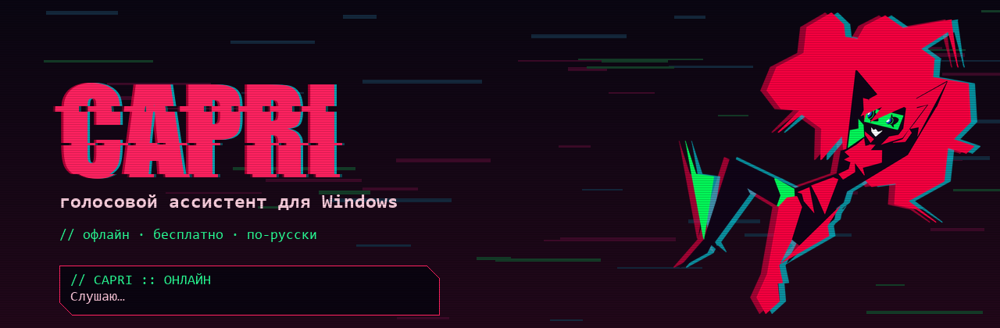
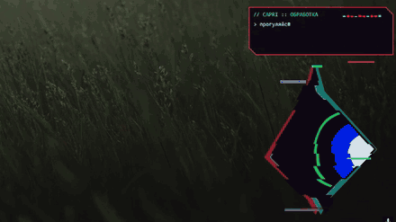

<p align="center">
  
</p>

<p align="center">
  
  
  
  
  
</p>

<p align="center">
  <b>Капри (Capri)</b> — голосовой ассистент в стиле киберпанка для Windows. Живёт поверх окон, появляется с глитч-вспышками,<br>
  слушает команды на русском, управляет компьютером, открывает любые сайты и программы, работает с YouTube и Telegram,<br>
  а также болтает с помощью локальной нейросети или облачного ИИ.
</p>

> [!NOTE]
> **Оригинальный репозиторий проекта:** [kystt29/capricorn](https://github.com/kystt29/capricorn)  
> Данная версия является расширенным и доработанным форком с исправлением багов оригинальной версии, поддержкой открытия любых веб-сайтов в реальном времени, улучшенной интеграцией с Telegram, YouTube и защитой от ложных срабатываний в Discord.

---

<p align="center">
  
  &nbsp;
  
</p>

<p align="center">
  
</p>

---

## ⚡ Что изменено и улучшено по сравнению с оригиналом

В этой версии устранены ключевые проблемы оригинального репозитория [kystt29/capricorn](https://github.com/kystt29/capricorn) и добавлен обширный новый функционал:

### 1. 🌐 Умное открытие абсолютно любого веб-сайта
* **Было в оригинале:** в `config.json` было прописано всего 23 жестко зашитых сайта. Если пользователь просил открыть любой другой сайт, Капри говорила *«Такого сайта не знаю...»* и перенаправляла в Google Поиск, либо пыталась искать его как программу на диске и выдавала ошибку *«Не нашла приложение на твоей машине»*.
* **Стало:**
  * **Встроенная база популярных сервисов (`DEFAULT_SITES`)**: более 100 популярных сайтов (Хабр, ДНС, Госуслуги, Реддит, Пикабу, Мангалиб, HDRezka, Кинокрад, AnimeGO, RuTracker, Steam, Speedtest, Figma, Notion, DeepSeek, маркетплейсы, банки и онлайн-инструменты) открываются мгновенно с нулевой задержкой.
  * **Распознавание доменов голосом (`parse_spoken_domain`)**: Капри понимает сказанные домены (*«открой хабр точка ком»*, *«зайди на твич точка тв»*, *«открой мангалиб точка ми»*, *«reddit.com»*, *«президент точка рф»*). Домены автоматически транслитерируются и открываются в браузере.
  * **Скоростной динамический веб-резолвер (`resolve_site_url`)**: если запрошен редкий, нишевый или совершенно новый сайт, Капри определяет его точный канонический URL через скоростной API Google Chrome Suggest / Google Feeling Lucky (~200 мс) и сразу открывает целевую страницу.
  * **Автопереход при отсутствии локальной программы**: если сказать просто *«открой хабр»* или *«открой мангалиб»* (без слова «сайт»), Капри проверяет наличие программы на ПК, и если её нет — автоматически открывает веб-сайт в браузере, а не жалуется на отсутствие приложения.
  * **Сохранен приоритет локальных программ**: фраза *«открой стим»* запустит программу Steam на ПК, а *«открой сайт стим»* или *«открой стим в браузере»* откроет веб-магазин в браузере.

### 2. 💬 Улучшенный Telegram и устранение перехвата команд
* **Было в оригинале:** при попытке открыть сайт, видео или выполнить поиск, если Telegram был открыт или запускался, Капри ошибочно перехватывала команду и начинала печатать текст запроса прямо в поисковую строку Telegram.
* **Стало:**
  * Добавлен строгий фильтр стоп-слов (`NON_CONTACT_WORDS`: видео, сайт, ролик, музыка, ютуб, страница, вкладка, настройки и др.). Непреднамеренная переадресация в Telegram полностью исключена.
  * Автоматический переход в Telegram срабатывает **только** тогда, когда окно `telegram.exe` действительно находится на переднем плане и запрос похож на имя контакта.
  * **Раздельный сценарий работы с чатами**:
    * Найти контакт: *«открой Лёха»*, *«найди в тг Сашу»*, *«перейди в чат с мамой»*.
    * Написать сообщение: *«напиши ему привет»*, *«отправь сообщение как дела»*. Реализован авто-стемминг падежей имен и очистка местоимений («ему», «ей», «в чат»).

### 3. 🎬 YouTube — каналы, конкретные видео и тренды
* **Было в оригинале:** поддерживался только общий поиск или запуск случайного ролика.
* **Стало:**
  * **Поиск и открытие каналов**: *«найди на ютубе канал <название>»*, *«открой канал <название>»*.
  * **Запуск конкретных видео**: *«открой на ютубе видео про космос»*, *«включи трек ... на ютубе»* с авто-стартом воспроизведения.
  * **Рекомендации и порядковые ролики**: понимает фразы *«открой первое видео на главной странице ютуба»*, *«включи первое видео в трендах»*, *«лучшее видео»*, *«первый ролик»*.

### 4. 🎙️ Защита от захвата чужой речи в Discord и фонового шума
* **Было в оригинале:** при общении с друзьями в Discord или при наличии фоновых разговоров фразы, сказанные за секунды **до** произнесения имени Капри, попадали в буфер распознавателя речи. Капри пыталась выполнить случайный обрывок чужого разговора.
* **Стало:**
  * Добавлена очистка пре-триггерного аудиобуфера и функция `strip_wake`, отсекающая любые слова, сказанные до имени ассистента. В команду попадает строго то, что произнесено **после** обращения к Капри.
  * Расширен список распознаваемых вариантов имени активации (`капри`, `капли`, `капле`, `capri`, `каприз`, `капре`, `кепри`, `катри`, `кабри`, `копри` и др.) для уверенного отклика с первого раза.

### 5. 🔊 Настройка комфортной громкости
* В `config.json` добавлен параметр `"voice_volume": "-75%"`, снижающий громкость синтезатора до комфортного уровня, чтобы Капри не глушила музыку, игры и голосовой чат.

### 6. 💻 Автоматическое распознавание программ ПК
* Просканированы и добавлены в `config.json` реальные установленные приложения пользователя с русскоязычными алиасами (*Telegram, Discord, Steam, OBS Studio, Chrome, VS Code, Яндекс Музыка и др.*).

---

## 🌟 Что умеет Капри

| Направление | Примеры возможностей |
|---|---|
| **Любые сайты** | «открой сайт хабр», «зайди на днс», «перейди на госуслуги», «открой реддит точка ком», «mangalib.me» |
| **Поиск в сети** | поиск в Google, поиск картинок, информация с голосовым пересказом из Википедии |
| **YouTube** | первое видео по теме, запуск треков, открытие каналов («найди на ютубе канал Utopia Show»), тренды |
| **Музыка и видео** | пауза, продолжить, следующий трек, «что играет», перемотка («поставь на 3:14», «на 20 секунд вперёд») |
| **Telegram** | открыть контакт («открой Лёха»), написать сообщение («напиши ему привет как дела») |
| **Программы и окна** | запуск и закрытие программ, завершение процессов («кильни дискорд»), вкладки, сворачивание окон |
| **Клавиши** | «нажми вин таб», «контрол шифт эскейп», «альт эф четыре» |
| **Файлы и папки** | открытие стандартных и пользовательских папок, создание файлов, заметок, документов и таблиц |
| **Система и ПК** | регулировка громкости и яркости, диагностика компьютера, проверка нагрузки на процессор и память |
| **Общение и ИИ** | локальная нейросеть через Ollama (без интернета) либо облачный Gemini / Claude с поиском в Google |
| **Анимация** | меняет позы, гуляет по экрану, реагирует глитч-эффектами, машет ручкой |

Полный список голосовых команд — в файле [КОМАНДЫ.md](КОМАНДЫ.md).

---

## 🚀 Установка

**Требования:** Windows 10 или 11, микрофон, интернет на время первоначальной установки.

### 1. Установи Python
Скачай и установи **Python 3.13** (или 3.11–3.14): [Официальный установщик Python для Windows (64-bit)](https://www.python.org/downloads/windows/).  
> [!IMPORTANT]
> При установке обязательно поставь галочку **«Add python.exe to PATH»**.

### 2. Скачай репозиторий
Нажми зелёную кнопку **Code → Download ZIP** вверху страницы и распакуй архив в удобную папку (например, `C:\Capri`).  
*(Рекомендуется путь без русских букв и спецсимволов для стабильной работы звуковых библиотек).*

### 3. Запусти установку
Запусти файл **`setup.bat`**.  
Скрипт установит необходимые Python-библиотеки и загрузит компактную офлайн-модель распознавания речи Vosk (~45 МБ). Дождись сообщения «Готово».

### 4. Запусти Капри
Запусти файл **`run.bat`**.  
Капри появится на экране, поздоровается, и в трее Windows (возле часов) появится её значок.  
Скажи в микрофон: **«Капри, открой ютуб»** или **«Капри, открой сайт хабр»** — если всё открылось, ассистент готов к работе!

---

## 🧠 Подключение нейросети (разговорный режим)

По умолчанию все команды управления Windows, мультимедиа и сайтами работают сразу и офлайн. Нейросеть нужна только для свободного диалога.

### Вариант 1: Бесплатный Gemini API (рекомендуется)
Дает быстрые, умные и содержательные ответы с актуальными данными:
1. Получи бесплатный ключ API в [Google AI Studio](https://aistudio.google.com/app/apikey).
2. В файле `config.json` укажи:
   ```json
   "enable_ai": true,
   "ai_provider": "gemini",
   "gemini_api_key": "твой_ключ_от_Google_AI_Studio",
   "model": "gemini-2.5-flash"
   ```

### Вариант 2: Локальная нейросеть через Ollama (полный офлайн)
Не требует интернета и не отправляет данные в сеть:
1. Скачай и установи [Ollama](https://ollama.com/download).
2. В командной строке загрузи русскоязычную модель:
   ```bash
   ollama pull qwen3:8b
   ```
   *(Для слабых ПК или видеокарт менее 6 ГБ видеопамяти используйте `ollama pull qwen3:4b-instruct`).*
3. В `config.json` убедись, что включено: `"local_ai": true`, `"local_model": "qwen3:8b"`.

---

## ⚙️ Настройки (`config.json`)

Файл `config.json` находится в корневой папке программы (также его можно открыть через меню правой кнопки мыши по иконке Капри в трее → **«Открыть config.json»**).

| Параметр | Описание |
|---|---|
| `wake_words` | Список слов активации, на которые откликается Капри (`капри`, `capri` и вариации) |
| `mic_device` | Имя микрофона (выбирается в меню трея или `null` для микрофона по умолчанию) |
| `voice_volume` | Громкость голоса ассистента (например, `"-75%"` для комфортного тихого звучания) |
| `voice` | Голос синтезатора речи (по умолчанию `"ru-RU-SvetlanaNeural"`) |
| `voice_rate`, `voice_pitch` | Скорость и высота тона речи |
| `voice_fx` | Цифровая киберпанк-обработка голоса (`0` — чистый звук, `1.0` — полный эффект) |
| `use_google_stt` | Дополнительное уточнение распознавания фразы через Google STT (`true` / `false`) |
| `barge_in` | Возможность перебивать речь Капри голосом («стоп», «хватит») |
| `sites` | Пользовательские закладки сайтов: `"название": "https://адрес"` |
| `apps`, `app_aliases` | Пользовательские приложения и их русскоязычные имена |
| `chatter`, `roam_chance` | Автономное поведение: случайные фразы и прогулки по экрану |
| `hide_after_seconds` | Время в секундах, через которое Капри исчезает с экрана при отсутствии команд |

После редактирования `config.json` перезапусти Капри через меню в трее → **«Выход»**, затем запусти `run.bat`.

---

## ❓ Возможные неполадки

<details>
<summary><b>Капри не слышит голос</b></summary>

- Кликни правой кнопкой мыши по иконке Капри в трее → **«Микрофон»** и выбери активный микрофон.
- Проверь в настройках Windows: *Параметры → Конфиденциальность → Микрофон* (доступ для классических приложений должен быть включен).
</details>

<details>
<summary><b>Капри открывает поиск вместо перехода на сайт</b></summary>

- Убедись, что запрос содержит слово «сайт», «в браузере» или домен: *«открой сайт хабр»*, *«зайди на сайт днс»*, *«открой reddit.com»*.
- Для редких названий используй проговаривание домена: *«открой мангалиб точка ми»*.
</details>

<details>
<summary><b>Ложные срабатывания при разговоре в Discord</b></summary>

- Капри уже настроена отсекать предваряющую речь, но если в комнате шумно, надень наушники или отключи перебивание (`"barge_in": false` в `config.json`).
</details>

---

## 📜 Благодарности и лицензия

- **Оригинальный проект:** [Capricorn (Капри)](https://github.com/kystt29/capricorn) от автора [@kystt29](https://github.com/kystt29). Огромная благодарность автору за великолепный концепт, спрайты и атмосферу!
- Некоммерческий фан-проект. Персонаж Капри и стилистика вселенной Cyberpunk принадлежат их уважаемым правообладателям.
